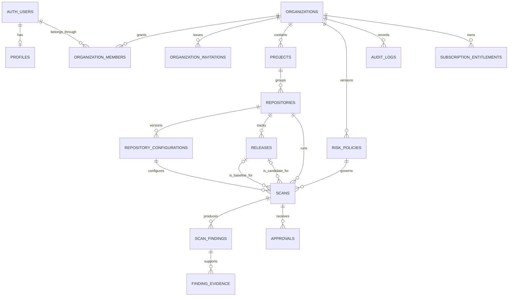

# ADR 001 · RollbackIQ foundation

**Status:** Accepted for the foundation. The tenant schema and hosted services below are implementation designs for later phases.

RollbackIQ uses a pnpm monorepo with a Next.js App Router web app, an independent TypeScript scanner, a CLI, and a composite GitHub Action. The scanner accepts SQL text and returns a versioned report. It parses PostgreSQL's AST through `libpg-query` and never connects to the database or executes migration SQL. The CLI owns filesystem access and process exit codes. The Git adapter reads changed blobs without running contributor code. The web app runs the same scanner on the Node.js server and exposes reports through a bounded JSON API.

Use a modular monolith for hosted features. Supabase Auth and Postgres will own sessions and tenant data. Gemini will consume minimized deterministic evidence on the server after Phase 4 authorization and persistence are in place. Reports preserve analyzer and parser versions. Findings keep independent severity and confidence so policies can flag an operation while acknowledging incomplete evidence. A scan with no findings means none of the implemented rules matched within the analyzed input.

## Monorepo

```text
apps/web/                         Next.js landing, demo workspace and REST routes
  app/api/                        Health and bounded scan endpoints
  app/workspace/                  Interactive demo shell, reports and session history
  components/                    Shared brand and report UI
packages/scanner-core/src/        AST adapter, rule registry, report and policy contracts
packages/cli/src/                 Filesystem CLI and Git comparison adapter
integrations/github-action/       Composite action and consumer setup
examples/demo-saas/               Synthetic migrations and fixture manifest
docs/                            Architecture, scanner/API and phase record
.github/workflows/               Build checks and trusted-base migration scan
```

Parser, rules and reporting start as modules inside `scanner-core`. Split them into separate packages when independent release cycles or consumers justify the extra interfaces. Add `supabase/migrations` and Supabase database tests in Phase 4.

## Proposed database model



| Entity                       | Important columns and constraints                                                                                                                                                |
| ---------------------------- | -------------------------------------------------------------------------------------------------------------------------------------------------------------------------------- |
| Profiles                     | `user_id` references `auth.users`, display name, timestamps.                                                                                                                     |
| Organizations, projects      | UUID, name, slug, settings. Project slugs unique within the organization.                                                                                                        |
| Members, invitations         | Organization and user IDs with a unique membership and owner/admin/developer/viewer role. Expiring invitations keep a token hash and acceptance state.                           |
| Repositories, configurations | Tenant/project IDs, provider and stable provider repository ID, monitoring flag. Immutable versions record branch and migration paths.                                           |
| Releases                     | Tenant/repository IDs, commit SHA and recorded branch. Unique by repository and SHA.                                                                                             |
| Policies                     | Tenant ID, stable policy key, version, severity threshold and incomplete-coverage behavior.                                                                                      |
| Scans                        | Tenant/repository IDs, baseline and candidate release, config/policy versions, analyzer version, state, duration, trigger, idempotency key and timestamps.                       |
| Findings, evidence           | Tenant and parent IDs, stable report finding key, rule, severity, confidence, source range, object and review state. Evidence stores supported source references and provenance. |
| Approvals                    | Tenant/scan IDs, reviewer, decision, timestamp and review comment.                                                                                                               |
| Audit logs                   | Tenant, actor, action, resource, timestamp and minimized metadata.                                                                                                               |
| Entitlements                 | Tenant, plan, feature, limit and effective period.                                                                                                                               |

Tenant rows use `organization_id`. Composite foreign keys include the tenant and, where necessary, repository ID so rows cannot link to another tenant's or repository's parent. Index membership by user and organization, foreign-key columns, and scan history by `(organization_id, repository_id, created_at desc, id)`. Apply deny-by-default RLS to exposed tables, grant only the intended operations, and perform server-side role checks for mutations. Use a transaction for organization creation and owner membership. Tenant-isolation tests must cover reads, writes and foreign-key mismatches before hosted deployment. [Supabase RLS documentation](https://supabase.com/docs/guides/database/postgres/row-level-security)

## Scanner contract

```ts
type MigrationFile = { path: string; sql: string };
type Confidence = "confirmed" | "potential" | "unknown";
type Severity = "critical" | "high" | "medium" | "low" | "info";
scanMigrations(files: readonly MigrationFile[]): Promise<ScanReport>;
evaluatePolicy(report: ScanReport, policy: ScanPolicy): PolicyDecision;
toSarif(report: ScanReport): SarifLog;
```

The parser adapter emits normalized changes and parser coverage diagnostics. A rule consumes a change and emits findings with stable IDs, evidence and source locations. A report contains the analyzed files, operation counts, coverage, findings and PostgreSQL parser version. The policy is evaluated outside the scanner so CLI and CI consumers can choose their own failure threshold. Compatibility classification stays `unknown` until a supported comparison has run.

| Rule  | Default severity | Evidence                                                                             |
| ----- | ---------------- | ------------------------------------------------------------------------------------ |
| PG001 | Critical         | AST names a table in `DROP TABLE`.                                                   |
| PG002 | High             | `ALTER TABLE` contains `DROP COLUMN`.                                                |
| PG003 | High             | `ALTER TABLE` renames a column.                                                      |
| PG004 | High             | `ALTER TABLE` changes a column type.                                                 |
| PG005 | Medium           | `ALTER TABLE` sets a column `NOT NULL`.                                              |
| PG006 | Medium           | `ALTER TABLE` adds or drops a constraint.                                            |
| PG007 | Medium           | Supported DDL suggests lock or write impact, including non-concurrent index changes. |
| PG008 | Medium           | Index removal or unique index creation may affect writes or query plans.             |
| PG900 | Info             | PostgreSQL parsed a statement or subcommand outside coverage.                        |
| PG901 | High             | The parser rejected the file. Coverage is incomplete.                                |

## Environment and setup

Node.js 22.13+ and pnpm 11.25.0 are used for local development. Git is required for the comparison CLI. No credentials or external services are required for the foundation.

```bash
npm install --global pnpm@11.25.0
pnpm install --frozen-lockfile
pnpm dev
pnpm check
pnpm scan examples/demo-saas/migrations/002_drop_legacy_tier.sql
```

The optional team workspace reads `NEXT_PUBLIC_SUPABASE_URL`, `NEXT_PUBLIC_SUPABASE_PUBLISHABLE_KEY` and `APP_URL`. The authenticated request identity drives database authorization. `GEMINI_ENABLED`, `GEMINI_API_KEY` and `GEMINI_MODEL` configure server-side explanations. GitHub App placeholders in `.env.example` are reserved for later hosted repository linking. [Team workspace configuration](team-workspace.md)

## Milestones

1. Establish the monorepo, local app shell, interfaces, linting, formatting and test commands.
2. Validate supported PostgreSQL operations, coverage diagnostics, policy gates and JSON/SARIF output in the standalone scanner.
3. Compare release snapshots and match direct SQL and supported Prisma/TypeScript dependencies with source evidence.
4. Implement local Supabase migrations, authentication, onboarding, RLS, persistent reports and authenticated APIs.
5. Deliver tenant dashboard, repository settings, review workflows, history and team management.
6. Add evidence-grounded Gemini explanations, usage controls and validation.
7. Release and test the consumer GitHub Action, then add hosted ingestion and GitHub App support.
8. Run tenant, end-to-end and operational verification and document deployment and recovery.
